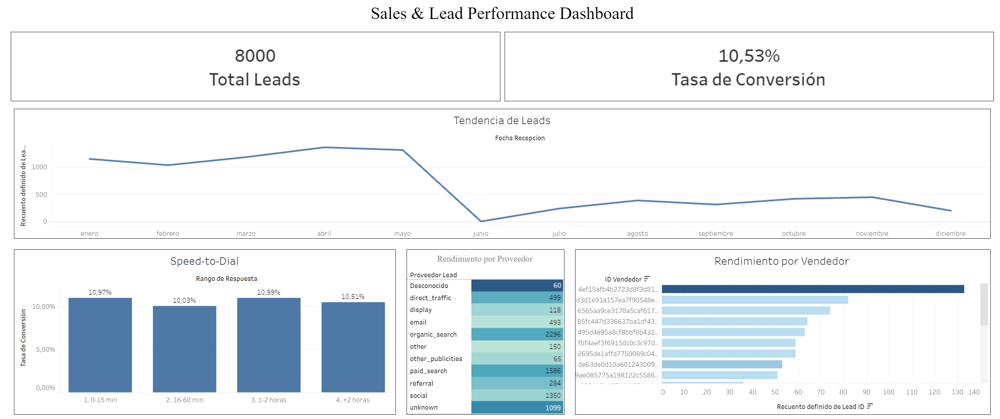
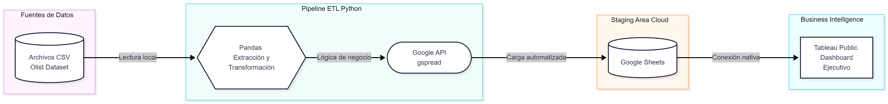
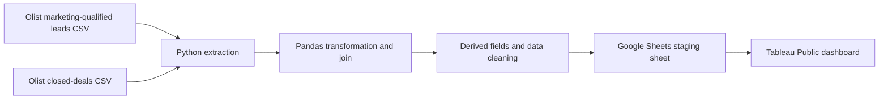

<div align="center">

# Sales & Lead Performance Analytics

**An end-to-end ETL and business intelligence portfolio project using Python, Pandas, Google Sheets, and Tableau.**

[](https://www.python.org/)
[](https://pandas.pydata.org/)
[](https://developers.google.com/sheets/api)
[](https://public.tableau.com/)
[](#scope-and-limitations)

</div>

---

## Overview

**Sales & Lead Performance Analytics** demonstrates a modular Python ETL pipeline and a Tableau Public dashboard for exploring a sales-lead funnel. The workflow extracts public marketing-qualified lead and closed-deal data, joins the two datasets, standardizes fields, derives reporting attributes, and loads the resulting dataset into Google Sheets for visualization in Tableau.

> **Data transparency:** This is a portfolio project based on public Olist data. The `Minutos_Respuesta` (response time) and `Costo_Lead` (lead cost) fields are simulated for demonstration and must not be interpreted as observed outcomes from a real sales team or client.

## Business questions

The dashboard is designed to explore questions such as:

1. How does lead conversion vary across lead sources?
2. How do sales outcomes differ by business segment or sales representative?
3. What does the distribution of leads and closed deals look like over time?
4. How would response-time scenarios affect conversion analysis if real response-time data were available?

The last question is exploratory: response-time values in the current project are simulated, so the dashboard cannot establish a real-world relationship between response time and conversion.

## Interactive dashboard

**[Open the Sales & Lead Performance Dashboard on Tableau Public](https://public.tableau.com/app/profile/fabian.cristobal/viz/Sales-Lead-Performance-Dashboard/SalesLeadPerformanceDashboar?publish=yes)**

<p align="center">
  <a href="https://public.tableau.com/app/profile/fabian.cristobal/viz/Sales-Lead-Performance-Dashboard/SalesLeadPerformanceDashboar?publish=yes">
    
  </a>
</p>

## Data source

The project uses the public [Olist Marketing Funnel dataset on Kaggle](https://www.kaggle.com/datasets/olistbr/marketing-funnel-olist), specifically these files:

- `olist_marketing_qualified_leads_dataset.csv`
- `olist_closed_deals_dataset.csv`

The source files are read from the local `data/` directory. Download or provide them separately as needed for your environment; do not assume raw data files are included in every clone of the repository.

## Architecture

<p align="center">
  
</p>



## ETL workflow

The code separates extraction, transformation, and loading into independent modules, with `main.py` coordinating the workflow.

| Stage | Implementation | Purpose |
|---|---|---|
| Extraction | `etl/extraction.py` | Reads the two Olist CSV files into Pandas DataFrames. |
| Transformation | `etl/transform.py` | Left-joins leads to closed deals by `mql_id`, selects relevant columns, standardizes field names, fills selected missing values, and derives reporting fields. |
| Loading | `etl/loading.py` | Authenticates with a Google service account and writes the transformed DataFrame to the configured Google Sheet. |
| Orchestration | `main.py` | Calls extraction, transformation, and loading in sequence. |
| Visualization | Tableau Public | Uses the Google Sheets data to support interactive sales-funnel analysis. |

## Important distinction: observed and simulated fields

To keep the dashboard interpretable, the following distinction is essential:

| Field | Treatment | Interpretation |
|---|---|---|
| Lead source, first contact date, sales representative, business segment, deal date, declared monthly revenue | Derived from the public source tables, with selected column renaming/cleaning | Describes information available in the source dataset. |
| `Minutos_Respuesta` | **Simulated** | Generated with an exponential distribution (scale of 45 minutes) using a fixed random seed to make runs reproducible. It is not an observed response-time measurement. |
| `Costo_Lead` | **Simulated** | Assigned using illustrative cost values by lead source, with a fallback value for other sources. It is not an actual campaign cost or validated acquisition cost. |
| Conversion/closed-deal status | Derived | A lead is marked as `Vendido` when a deal date is present and `Perdido` otherwise, per the project's transformation logic. |

Consequently, charts comparing response time or lead cost are **demonstrations using simulated fields**, not evidence of actual causal effects or business performance. Replace these fields with measured client data before using such analysis for operational decisions.

## Repository structure

```text
SLF-Analytics-Dashboard/
├── .vscode/                       # Local editor settings
├── data/                          # Source CSV files used by the ETL
├── etl/
│   ├── extraction.py               # Reads the source datasets
│   ├── transform.py                # Joins, cleans, and derives fields
│   └── loading.py                  # Writes data to Google Sheets
├── images/
│   ├── Architecture-Diagram.png
│   └── Dashboard-Preview.png
├── .env.example                    # Example environment configuration
├── .gitignore
├── main.py                         # ETL orchestration
├── requirements.txt
└── README.md
```

## Getting started

### Prerequisites

- Python 3.x and pip.
- The two Olist CSV files referenced in [Data source](#data-source), placed in `data/`.
- A Google Cloud service account with the required Google Sheets/Drive API access.
- A Google spreadsheet named `SLF-Analytics-Dashboard_Data` shared with the service-account email with editing permission.
- A Tableau Public account or access to the published dashboard to explore the visualization.

### 1. Clone the repository

```bash
git clone https://github.com/Fab0705/SLF-Analytics-Dashboard.git
cd SLF-Analytics-Dashboard
```

### 2. Create a virtual environment and install dependencies

**Windows (PowerShell):**

```powershell
python -m venv .venv
.venv\Scripts\Activate.ps1
pip install -r requirements.txt
```

**macOS / Linux:**

```bash
python3 -m venv .venv
source .venv/bin/activate
pip install -r requirements.txt
```

### 3. Prepare the input data

Place these files in `data/`:

```text
data/
├── olist_marketing_qualified_leads_dataset.csv
└── olist_closed_deals_dataset.csv
```

The extraction module expects these filenames and relative paths. If you store the files elsewhere, update `etl/extraction.py` accordingly.

### 4. Configure Google Sheets credentials

1. Create or select a Google Cloud project and enable the APIs required for the integration.
2. Create a service account and download its JSON key file.
3. Save the JSON key locally, for example as `credenciales.json` in the repository root. **Never commit this file or any credentials to GitHub.**
4. Copy `.env.example` to `.env`.

   **Windows (PowerShell):**

   ```powershell
   Copy-Item .env.example .env
   ```

   **macOS / Linux:**

   ```bash
   cp .env.example .env
   ```

5. Verify that `.env` points to your credentials file:

   ```dotenv
   GOOGLE_CREDENTIALS_PATH=credenciales.json
   ```

6. Share the Google spreadsheet named `SLF-Analytics-Dashboard_Data` with the service account's email address, granting edit access.

The `.env` file and `credenciales.json` should remain local and untracked.

### 5. Run the ETL pipeline

From the repository root:

```bash
python main.py
```

The script extracts the CSV files, transforms and joins the data, then writes the resulting DataFrame to the first worksheet of `SLF-Analytics-Dashboard_Data`.

> **Important:** The current loading code clears the target worksheet before writing the refreshed dataset. Run it only against the designated project spreadsheet and keep a backup of any data you need to preserve.

### 6. Explore the Tableau dashboard

Open the [published Tableau Public dashboard](https://public.tableau.com/app/profile/fabian.cristobal/viz/Sales-Lead-Performance-Dashboard/SalesLeadPerformanceDashboar?publish=yes). The live dashboard is available for exploration; running the ETL locally requires your own source data and Google Sheets credentials.

## Technology stack

| Technology | Role |
|---|---|
| Python | ETL orchestration and transformation logic |
| Pandas | Data manipulation and joining source tables |
| NumPy | Reproducible generation of illustrative response-time fields |
| Google Sheets API / gspread | Cloud staging and dataset loading |
| Google service account | Programmatic authentication |
| python-dotenv | Loading local environment configuration |
| Tableau Public | Interactive visualization and dashboard sharing |
| Git / GitHub | Version control and technical documentation |

## Scope and limitations

- This is a public-data portfolio project, not a production sales system or a client engagement.
- `Minutos_Respuesta` and `Costo_Lead` are simulated variables. Findings involving these fields are illustrative only.
- The project does not demonstrate a causal relationship between response time, lead source, cost, and sales conversion.
- The pipeline writes to a named Google spreadsheet and clears its first worksheet before writing; configure the correct target before running it.
- API credentials are not included. Each user must configure their own credentials securely.
- Tableau Public is a public-sharing platform. Do not connect confidential business or personal data to a public workbook.

## Potential next steps

- Add validation checks for expected columns, duplicate IDs, missing keys, and output row counts.
- Add unit tests for the extraction and transformation functions.
- Replace simulated response-time and lead-cost values with measured data when available.
- Add structured logging and clearer error handling for API failures.
- Document Tableau metric definitions and provide a reproducible refresh procedure.

## Acknowledgments

- Dataset: [Olist Marketing Funnel — Kaggle](https://www.kaggle.com/datasets/olistbr/marketing-funnel-olist).
- Tools: Python, Pandas, NumPy, Google Sheets API, and Tableau Public.
